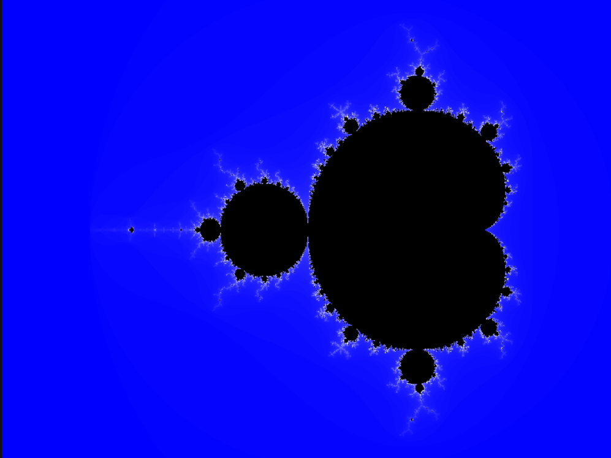

# Mandelbrot CUDA

A CUDA, NumPy, and Python CPU Mandelbrot renderer using the same `800x600` image and 100-iteration limit.


## Features

- CUDA kernel benchmark with one warm-up and 10 steady-state launches
- CPU and NumPy reference renderers
- Binary iteration output converted to PNG with Pillow

## Benchmark

Measured on an NVIDIA GeForce RTX 5050 Laptop GPU (compute capability 12.0), CUDA 13.4, Windows 11.

| Renderer | Timing | Result |
| --- | --- | ---: |
| Python CPU | render and image generation | 2.210 s |
| NumPy | end-to-end process wall time | 2.135 s |
| CUDA | kernel-only average, 10 runs after warm-up | 0.0344 ms |

The CUDA result excludes allocation, host-device copies, PNG generation, and file I/O. These timings should not be used as a direct speedup claim because the measured work differs.

## Prerequisites

- Windows 11 with an NVIDIA GPU and CUDA Toolkit 13.4+
- MSVC Build Tools available to `nvcc`
- Python 3.11+

## Build and run

```powershell
python -m venv .venv
.\.venv\Scripts\Activate.ps1
pip install -r requirements.txt
nvcc -O2 -arch=sm_120 -o mandelbrot.exe mandelbrot.cu
.\mandelbrot.exe
python save_image.py
python mandelbrot_cpu.py
python mandelbrot_numpy.py
```

## Outputs

- `iterations.bin`
- `mandelbrot_cuda.png`
- `mandelbrot_cpu.png`
- `mandelbrot_numpy.png`
